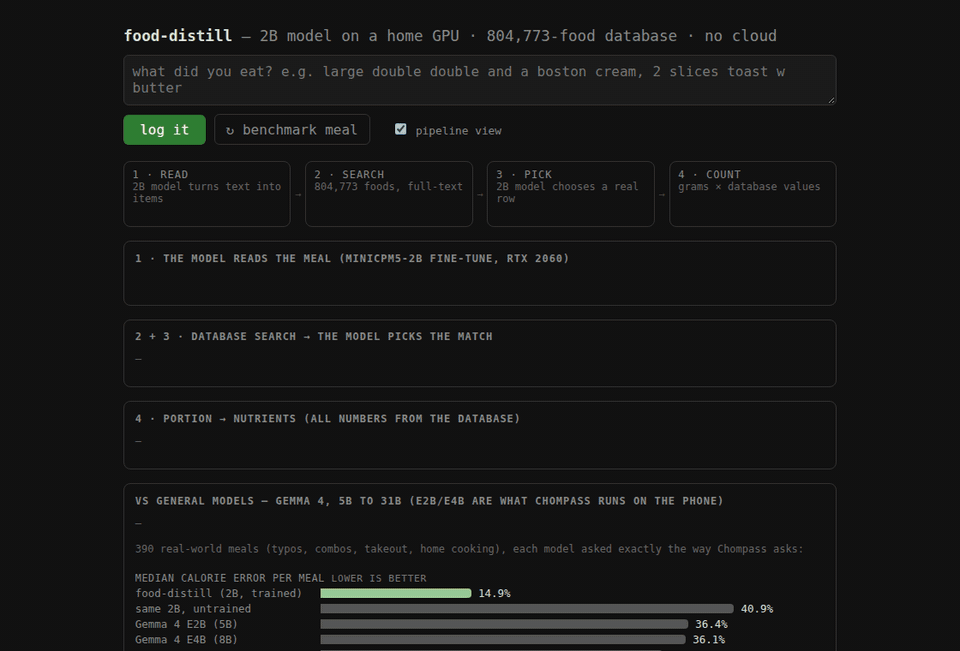
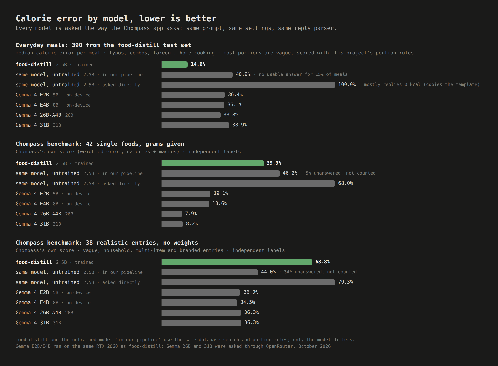
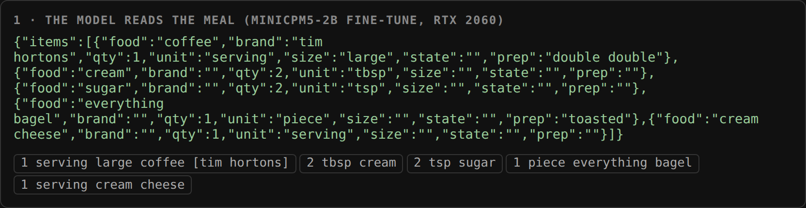
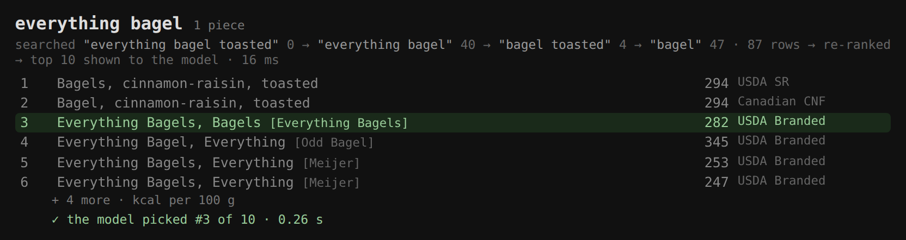
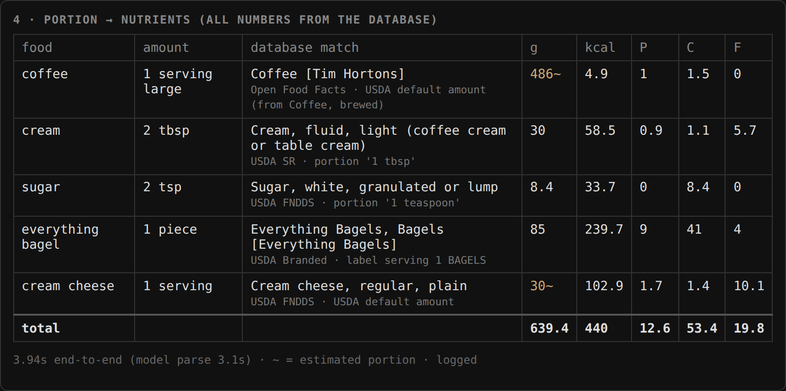
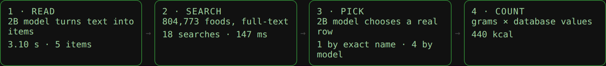

# food-distill

**Type a meal the way you'd text it. Get calories from real food databases, not from an AI's guess.**

food-distill turns `"bug mac meal w a diet coke"` into calories and macros. A 2.5B model, fine-tuned at home on
a 2019 gaming GPU (RTX 2060), does only two narrow jobs: it **reads** the meal into items, and it **picks** the
matching entry out of an 804,773-food database built from USDA, Health Canada, UK, French and Open Food Facts
data. Every gram and every calorie comes from that database. The model never produces a number, so every result
traces back to its source.

It is a distillation project: a large model labelled tens of thousands of example meals, the small model learned
from those labels overnight, and a 2,199-meal test set it never saw decides whether it worked. Total API spend:
under $10.



```
"bug mac meal w a diet coke"
        │
        ▼
 1 · READ    2.5B model (llama.cpp, grammar-constrained JSON)
             → big mac ×1 [mcdonald's] · french fries, medium [mcdonald's] · diet coke, medium
        │
        ▼
 2 · SEARCH  full-text search over 804,773 foods (SQLite FTS5, aliases, word-dropping backoff)
             → top 10 candidate rows per item
        │
        ▼
 3 · PICK    the same model chooses the right row (an exact name match skips it)
        │
        ▼
 4 · COUNT   grams from the database's own portions (or the amount you typed)
             × the row's nutrients per 100 g  →  943 kcal · 30 g protein · 94 g carbs · 51 g fat
```

## Head-to-head

The open-source calorie app [Chompass](https://codeberg.org/fitguy/Chompass) runs Google's Gemma 4 on the phone
and asks it to estimate a meal's calories directly. Each model below was asked **exactly the way Chompass asks**:
same prompt, same sampling settings, same reply parser. It also includes the base model food-distill
started from, **before training**, both inside this pipeline and asked directly.



**Everyday meals**: 390 meals from the test set (typos, combos, takeout, home cooking).

| model | size | median calorie error | meals within 10% | time per meal |
|---|---|---|---|---|
| **food-distill** | 2.5B, trained | **14.9%** | **42%** | **0.75 s** |
| same model, untrained, in this pipeline | 2.5B | 40.9% | 22% | 0.90 s |
| same model, untrained, asked directly | 2.5B | 100% (mostly replies 0 kcal) | 2% | 0.62 s |
| Gemma 4 E2B (what Chompass runs) | 5B | 36.4% | 16% | 1.35 s |
| Gemma 4 E4B (what Chompass runs) | 8B | 36.1% | 17% | 2.31 s |
| Gemma 4 26B-A4B | 26B | 33.8% | 21% | cloud |
| Gemma 4 31B | 31B | 38.9% | 17% | cloud |

Times are on the same RTX 2060. The two big Gemmas were asked through OpenRouter, so their times aren't comparable.

**Chompass's own benchmark**: their manifests, scored with their own definitions (weighted error over calories +
macros, share of items within 20% of the true calories).

| model | 42 single foods, grams given | 38 realistic entries, no weights |
|---|---|---|
| **food-distill** | 39.9% · 69% within 20% | 68.8% · 47% within 20% |
| same model, untrained, in this pipeline | 46.2% · 57% (5% unanswered) | 44.0% · 40% (34% unanswered) |
| same model, untrained, asked directly | 68.0% · 21% | 79.3% · 11% |
| Gemma 4 E2B | 19.1% · 74% | 36.0% · 55% |
| Gemma 4 E4B | 18.6% · 74% | 34.5% · 58% |
| Gemma 4 26B-A4B | **7.9% · 88%** | 36.3% · 55% |
| Gemma 4 31B | 8.2% · 83% | 36.3% · **61%** |

Chompass's weighted error only counts answered items, which is why the untrained model's 44.0% looks better than it is.

### Reading the results

- **Training is what makes it work.** The same 2.5B model in the same pipeline, before training, has a 40.9% median
  error and gives no usable answer for 15% of meals. After training: 14.9%, and every meal answered.
- **On messy everyday meals it beats Gemma 4 models up to 12× its size**, and it's faster than the two that fit on
  a phone. Gemma's errors don't shrink with size here (31B: 38.9%). Guessing a whole meal's calories in one
  number is the hard part, and a bigger guesser is still guessing.
- **Caveat: the everyday-meal score is partly ours.** Most of those meals have vague portions ("a bowl of", "1
  serving"), and the true grams for them come from this project's own portion rules, which favours food-distill.
  On the 13 meals where every item is weighed, there's nothing to argue about: food-distill 5.1% median error,
  Gemma 4 31B 5.3%, E4B 14.5%, E2B 21.2%.
- **On Chompass's benchmark, Gemma wins.** Checked item by item, three reasons:
  1. *Serving-size conventions.* Their truth for a bare branded food is one label serving ("Nutella" = 1 tbsp);
     food-distill logs a typical eaten amount, and sometimes the whole package.
  2. *Database gaps.* No ready-to-drink protein shake row exists, so "whey protein shake, 330 ml" matched a powder
     and came out 11× too high. One miss like that dominates a weighted score.
  3. *Several valid rows.* Farmed vs wild salmon, potato with or without skin: they score one specific USDA
    row, and food-distill often picks a different valid one.

All raw replies, the scoring scripts and the truth files are in [`results/`](results/) and
[`scripts/compare_chompass.py`](scripts/compare_chompass.py) / [`compare_chompass_suite.py`](scripts/compare_chompass_suite.py).

## A meal, step by step

`"large double double and a toasted everything bagel w cream cheese"`: the Tim Hortons order expands into what's
actually in it (coffee, 2 tbsp cream, 2 tsp sugar), and the cream cheese is its own item.

| **① Read**: the model turns text into items | **② Search & pick**: candidates from the database, the model's choice highlighted |
|---|---|
|  |  |
| **③ Count**: grams × database values, with the source of every number | **④ The pipeline at a glance**: timings for each step |
|  |  |

## How it was built

The full story, with numbers at each step, is in [docs/HOW-IT-WAS-BUILT.md](docs/HOW-IT-WAS-BUILT.md). In short:

1. **Contract first.** A written spec of how a meal becomes items (`prompts/parse_system_v2.txt`): ingredients raw
   unless cooking is stated, grains in dry weight, added calories (butter, cream, sauces) as their own items,
   named meals expanded to components.
2. **Test set before training.** 2,199 realistic meals, each labelled twice blind with disagreements adjudicated;
   correct database rows labelled for 400 of them (`eval/v2/`).
3. **Teacher data.** Claude Haiku 5.5 (picked in a bake-off) wrote ~32k food-diary lines and labelled ~16k of them, then
   made ~14k pick decisions over real search results. Every paid call runs under a hard budget cap.
4. **Student training.** QLoRA fine-tune of [MiniCPM5-2B](https://huggingface.co/openbmb/MiniCPM5-2B) on the RTX
   2060: 36,646 rows, 2 epochs, 9 hours overnight, power-capped after two crashes at full power.
5. **Measure every stage**: reading, search recall, picking and final calories, scored separately so every error
   has an address (`scripts/eval_v5.py`).

## What's in this repo

| Path | What |
|---|---|
| `app/pipeline.py`, `app/fooddb.py` | the pipeline: parse → search → pick → portion → nutrients |
| `app/server.py`, `app/index.html` | the demo dashboard in the GIF (Python standard library only) |
| `app/chompass_shim.py` | an OpenAI-compatible endpoint so Chompass can use food-distill as a custom provider |
| `prompts/` | the parse contract, the student's prompt, the output grammar, the teacher's worked examples |
| `scripts/build_fooddb.py` | builds the 804,773-food database from the six public sources |
| `scripts/or_gen.py`, `or_label.py`, `or_pick.py` | teacher data generation (budget-capped) |
| `scripts/build_train_v5.py`, `train_student.py`, `export_student.py` | training set, QLoRA training, GGUF export |
| `scripts/eval_v5.py`, `score_parse.py`, `recall_check.py` | evaluation |
| `scripts/compare_chompass*.py` | the head-to-head above |
| `eval/v2/` | the 2,199-meal test set with its labelling spec, blind relabels and adjudication |
| `results/` | every model's raw replies for the head-to-head, and the reports |

Not included: the built database (312 MB, rebuilt from the public sources by `scripts/build_fooddb.py`), the model
weights, and the teacher-generated training data (the scripts that make it are here).

## Data sources

| Source | License |
|---|---|
| [USDA FoodData Central](https://fdc.nal.usda.gov/) (FNDDS, SR Legacy, Foundation, Branded) | public domain (CC0) |
| [Canadian Nutrient File](https://www.canada.ca/en/health-canada/services/food-nutrition/healthy-eating/nutrient-data.html), Health Canada | Open Government Licence – Canada |
| [CoFID](https://www.gov.uk/government/publications/composition-of-foods-integrated-dataset-cofid), UK | Open Government Licence v3.0 |
| [Ciqual](https://ciqual.anses.fr/), ANSES France | Licence Ouverte / Etalab 2.0 |
| [Open Food Facts](https://world.openfoodfacts.org/) | ODbL (database), DbCL (contents) |
| [MiniCPM5-2B](https://huggingface.co/openbmb/MiniCPM5-2B), OpenBMB (base model) | Apache-2.0 |

## License

Code and test set: [MIT](LICENSE). The food databases keep their own licenses (above) and aren't redistributed here.
